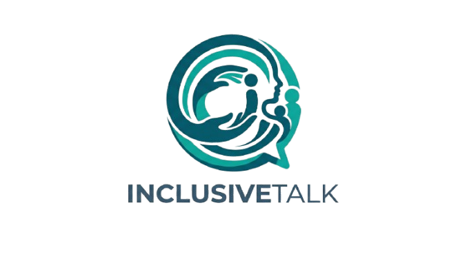
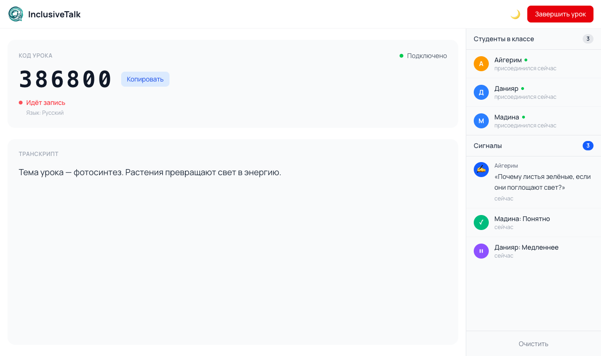
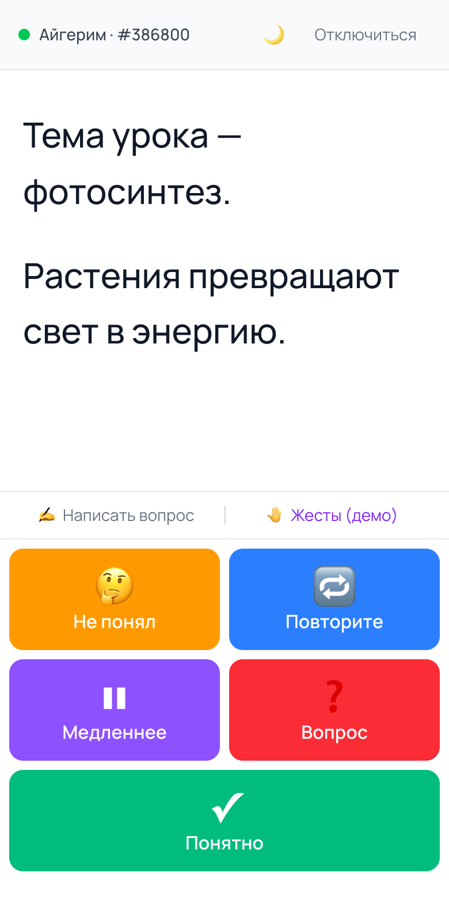
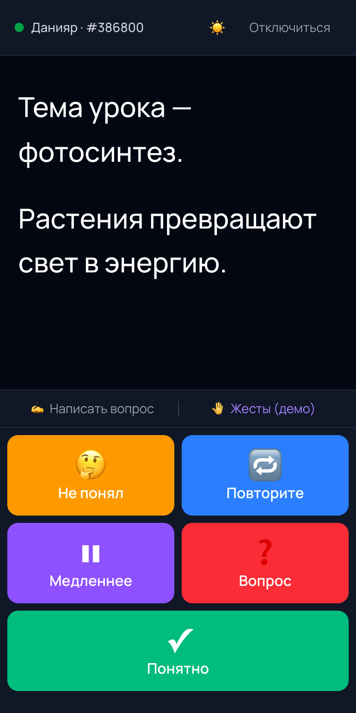
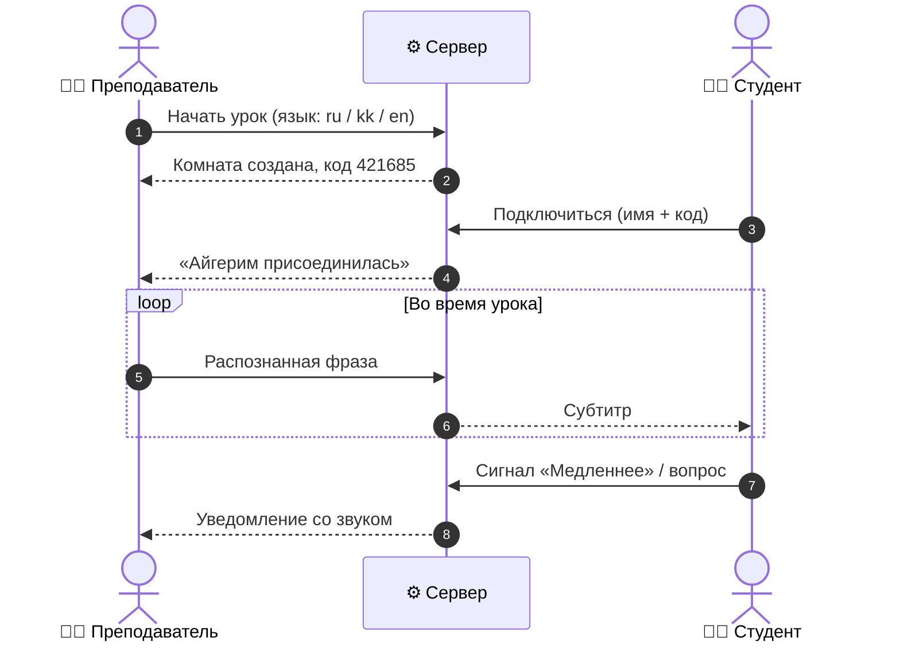

<div align="center">



### Живые субтитры для глухих и слабослышащих студентов

Преподаватель говорит — студенты читают его речь на своих телефонах в реальном времени.<br/>
Без сурдопереводчика, без установки приложений, без регистрации.

<br/>


<br/>


[Возможности](#-возможности) ·
[Как это работает](#-как-это-работает) ·
[Быстрый старт](#-быстрый-старт) ·
[Архитектура](#-архитектура) ·
[Roadmap](#-roadmap)

</div>

---

## 💡 Зачем

В Казахстане на одного сурдопереводчика приходится **500+ глухих людей**. В смешанных классах, где учатся слышащие и неслышащие студенты, переводчика чаще всего нет совсем — и глухой студент просто не слышит урок.

**InclusiveTalk** решает это одной ссылкой: преподаватель открывает сайт на ноутбуке и ведёт урок как обычно, а студенты вводят 6-значный код и видят каждое его слово крупным текстом на своём телефоне. Если что-то непонятно — студент нажимает одну кнопку, и преподаватель сразу это видит.

## 📸 Скриншоты

<div align="center">

**Преподаватель** — код урока, транскрипт, список студентов и сигналы



<br/><br/>

**Студент** — крупные субтитры и кнопки обратной связи (светлая и тёмная тема)


&nbsp;&nbsp;&nbsp;


</div>

## ✨ Возможности

| | Функция | Описание |
|---|---|---|
| 🎤 | **Живые субтитры** | Речь преподавателя распознаётся в браузере и мгновенно появляется у всех студентов |
| 🌍 | **Три языка урока** | Русский, казахский и английский — преподаватель выбирает язык перед началом |
| 🔢 | **Вход по коду** | Студенту достаточно имени и 6-значного кода — без регистрации и установки |
| 🚦 | **Быстрые сигналы** | «Не понял», «Повторите», «Медленнее», «Вопрос», «Понятно» — одним нажатием |
| ✍️ | **Вопросы преподавателю** | Студент пишет вопрос текстом, преподаватель видит его в боковой панели |
| 👥 | **Класс в реальном времени** | Преподаватель видит, кто подключился, и получает уведомление со звуком о каждом сигнале |
| 🔄 | **Устойчивость к обрывам** | Автопереподключение с экспоненциальной задержкой; урок живёт 60 секунд, пока преподаватель переподключается |
| 🗣️ | **Интерфейс студента на 3 языках** | Студент выбирает язык кнопок независимо от языка урока |
| 🌗 | **Светлая и тёмная тема** | Учитывает системную тему, переключается вручную |
| 📱 | **Mobile-first** | Крупный шрифт субтитров и большие кнопки, удобные на телефоне |
| 🤚 | **Жесты (демо)** | Прототип интерфейса распознавания жестового языка — задел на будущую фазу |

## 🔁 Как это работает



1. **Преподаватель** открывает страницу преподавателя, выбирает язык и нажимает «Начать урок».
2. Система генерирует **6-значный код** — преподаватель пишет его на доске или говорит вслух.
3. **Студенты** вводят имя и код на своих телефонах и подключаются к уроку.
4. Речь распознаётся через **Web Speech API** прямо в браузере преподавателя и по **WebSocket** рассылается всем студентам.
5. Студенты отправляют **сигналы и вопросы** — они появляются у преподавателя в боковой панели.

## 🏗 Архитектура

```text
┌──────────────────────────┐                         ┌──────────────────────────┐
│   Преподаватель          │                         │   Студенты               │
│   Next.js · /teacher     │                         │   Next.js · /student     │
│                          │                         │                          │
│   Web Speech API         │                         │   субтитры, сигналы,     │
│   (распознавание речи)   │                         │   вопросы                │
└────────────┬─────────────┘                         └─────────────┬────────────┘
             │  transcript ▲ signal / question                     │
             │             │ student_joined / left                 │
             ▼             │                                       ↕
         ┌─────────────────┴───────────────────────────────────────────┐
         │   Backend · Fastify + WebSocket  (/ws)                      │
         │                                                             │
         │   комнаты в памяти · токен преподавателя · heartbeat 30 с   │
         │   grace period 60 с · валидация всех сообщений              │
         └─────────────────────────────────────────────────────────────┘
```

Фронтенд и бэкенд разворачиваются независимо: фронтенд — статический Next.js (например, Vercel), бэкенд — Node.js-сервер с WebSocket (например, Railway). Связывает их одна переменная `NEXT_PUBLIC_WS_URL`.

<details>
<summary><b>WebSocket-протокол</b></summary>

<br/>

**Клиент → сервер**

| Тип | Кто отправляет | Поля |
|---|---|---|
| `register` | преподаватель | `role: "teacher"`, `code`, `language`, `token?` |
| `register` | студент | `role: "student"`, `code`, `name` |
| `transcript` | преподаватель | `text` |
| `signal` | студент | `signalType`: `confused` · `repeat` · `slow` · `question` · `understood` |
| `question` | студент | `text` (до 500 символов) |
| `gesture` | студент | `letter` |

**Сервер → клиент**

| Тип | Кому | Когда |
|---|---|---|
| `registered` | преподаватель | комната создана, в ответе список студентов и токен для переподключения |
| `joined` | студент | успешный вход в комнату |
| `transcript` | студенты | новая распознанная фраза |
| `student_joined` / `student_left` | преподаватель | студент вошёл / вышел |
| `signal` / `question` / `gesture` | преподаватель | обратная связь от студента |
| `teacher_disconnected` / `teacher_reconnected` | студенты | преподаватель потерял связь / вернулся |
| `room_closed` | студенты | урок завершён |
| `error` | любой | неверный код, занятая комната, пустое имя |

</details>

## 🚀 Быстрый старт

**Требования:** Node.js **20.9+**, npm, браузер **Chrome** или **Edge** для преподавателя (нужен Web Speech API).

```bash
git clone https://github.com/argamegg/inclusivetalk.git
cd inclusivetalk
```

**1. Бэкенд** — порт `3001`

```bash
cd backend
npm install
npm run dev
```

**2. Фронтенд** — порт `3000`, во втором терминале

```bash
npm install
npm run dev
```

**3. Открой** http://localhost:3000

- в одной вкладке — **«Я преподаватель»** → «Начать урок» → разреши доступ к микрофону;
- в другой вкладке или с телефона в той же сети — **«Я студент»** → введи имя и код.

> [!TIP]
> Чтобы подключиться с телефона, открой `http://<IP-твоего-компьютера>:3000`, а в `.env.local` укажи `NEXT_PUBLIC_WS_URL=ws://<IP-твоего-компьютера>:3001/ws`.

### Переменные окружения

| Где | Переменная | По умолчанию | Описание |
|---|---|---|---|
| фронтенд | `NEXT_PUBLIC_WS_URL` | `ws://localhost:3001/ws` | адрес WebSocket бэкенда (в продакшене — `wss://`) |
| бэкенд | `PORT` | `3001` | порт сервера |

Для фронтенда скопируй `.env.example` в `.env.local`. Локально можно ничего не задавать — значения по умолчанию подходят.

### Скрипты

| Команда | Что делает |
|---|---|
| `npm run dev` | фронтенд в режиме разработки |
| `npm run build` / `npm start` | продакшен-сборка и запуск фронтенда |
| `npm run lint` | проверка ESLint |
| `npm run typecheck` | проверка типов фронтенда |
| `cd backend && npm run dev` | бэкенд с автоперезапуском |
| `cd backend && npm start` | бэкенд без автоперезапуска |
| `cd backend && npm run typecheck` | проверка типов бэкенда |

## 🧰 Технологии

| Слой | Технология | Для чего |
|---|---|---|
| Frontend | **Next.js 16** (App Router, Turbopack) | страницы, сборка, SEO |
| | **React 19** | интерфейс |
| | **TypeScript 5** | типизация |
| | **Tailwind CSS 4** | стили, тёмная тема |
| | **Web Speech API** | распознавание речи в браузере |
| Backend | **Node.js** + **Fastify 5** | HTTP-сервер |
| | **@fastify/websocket** + **ws** | realtime-канал |
| | **tsx** | запуск TypeScript без сборки |

## 📁 Структура проекта

```text
inclusivetalk/
├── app/                        # Next.js — фронтенд
│   ├── page.tsx                # главная
│   ├── teacher/page.tsx        # экран преподавателя: распознавание речи, класс, сигналы
│   ├── student/page.tsx        # экран студента: субтитры, сигналы, вопросы
│   ├── components/
│   │   ├── SiteHeader.tsx      # шапка с логотипом и переключателем темы
│   │   ├── ThemeToggle.tsx     # светлая / тёмная тема
│   │   └── GestureMockModal.tsx# демо-интерфейс жестового перевода
│   ├── constants.ts            # языки, сигналы, адрес сервера, переподключение
│   ├── i18n.ts                 # переводы интерфейса студента (RU / KZ / EN)
│   ├── types.ts                # общие типы
│   ├── useMounted.ts           # хук для безопасной гидратации
│   ├── layout.tsx              # корневой layout, шрифт, метаданные
│   └── icon.tsx                # favicon
├── backend/                    # WebSocket-сервер
│   └── src/server.ts           # комнаты, рассылка субтитров и сигналов
├── docs/screenshots/           # скриншоты для README
├── public/                     # логотипы
├── types/speech.d.ts           # типы Web Speech API
├── ROADMAP.md                  # планы развития продукта
└── .env.example                # пример переменных окружения
```

## 🗺 Roadmap

- [x] **Фаза 1** — живые субтитры лекций на трёх языках
- [x] **Фаза 2** — обратная связь от студента: сигналы и вопросы преподавателю
- [ ] Сохранение транскрипта урока и личные кабинеты преподавателей
- [ ] Более точный движок распознавания речи для казахского языка
- [ ] **Фаза 3** — распознавание Русского Жестового Языка (MediaPipe + датасет Slovo)

Подробный план — в [ROADMAP.md](ROADMAP.md).

## ⚠️ Ограничения прототипа

- Распознавание речи работает только в **Chrome** и **Edge** — это ограничение Web Speech API.
- Комнаты хранятся **в памяти сервера**: после перезапуска бэкенда активные уроки сбрасываются.
- Окно «Жесты» — **демо интерфейса**, буква выбирается случайно; настоящее распознавание — в Фазе 3.

<div align="center">
<br/>
<sub>Сделано преподавателем — для студентов, которым урок должен быть слышен так же, как всем остальным.</sub>
</div>
